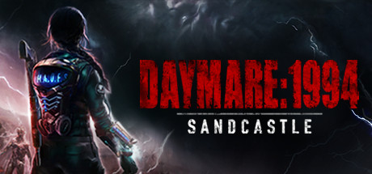

**Daymare: 1994 Sandcastle is the prequel following H.A.D.E.S. agent Dalila Reyes investigating a secret research facility that suffered a catastrophic containment failure. Features the unique Frost Grip device for freezing and manipulating enemies.**

---

## 📖 About

Daymare: 1994 Sandcastle is the prequel following H.A.D.E.S. agent Dalila Reyes investigating a secret research facility that suffered a catastrophic containment failure. Features the unique Frost Grip device for freezing and manipulating enemies.

## ⚠️ Problems Without Trainer

| Problem | Status |
|---------|--------|
| **Frost Grip Ammo** — The freezing device runs out quickly and must be recharged at specific terminals | ✅ Solved |
| **Frozen Enemy Timing** — Shattering frozen enemies has a limited window before they thaw | ✅ Solved |
| **Terminal Locations** — Finding recharge terminals while managing frozen enemies creates pressure | ✅ Solved |
| **Soldier Enemies** — Armed human enemies require multiple freezes before becoming vulnerable | ✅ Solved |

## ✅ Solution

The **Daymare: 1994 Sandcastle Trainer** solves all these issues by giving you complete control over the game.

## 🎯 Full Feature List

- Unlimited Resources
- God Mode / Invincibility
- Instant Skill Cooldown
- One-Hit Kill
- Freeze Game Timer
- Unlock All Items & Achievements
- Custom Speed Multiplier
- Save State Anywhere

## 🚀 Quick Start

1. **Disable Windows Defender** temporarily (trainer may trigger false positive)
2. Download the trainer from the button above
3. Launch Daymare: 1994 Sandcastle
4. Run the trainer as Administrator
5. Activate desired cheats with hotkeys

## 💎 Free vs Paid

| Feature | Free | Pro |
|---------|------|-----|
| Basic God Mode | ✅ | ✅ |
| Unlimited Resources | ✅ | ✅ |
| All Advanced Cheats | ❌ | ✅ |
| Auto-Updates | ❌ | ✅ |
| Priority Support | ❌ | ✅ |

## 💻 Requirements

- Windows 10/11 (64-bit)
- Daymare: 1994 Sandcastle (any version)
- .NET Framework 4.8+
- DirectX 11+

## 🍎 macOS

macOS users can use our alternative tool:

## ⚖️ Legal

This trainer is for educational and single-player use only. Use responsibly.

---

